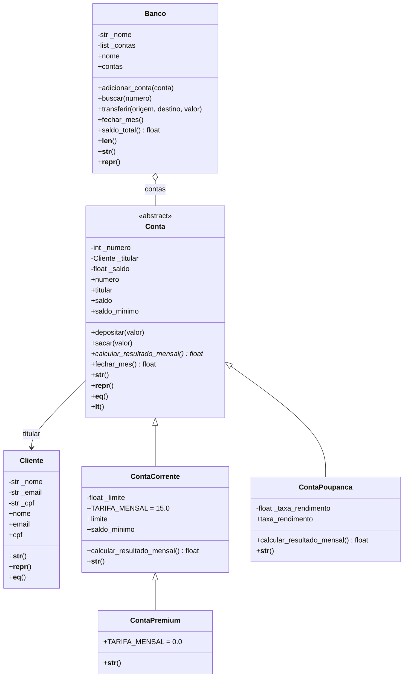

# Sistema Bancário Orientado a Objetos

Sistema em Python que modela um banco com clientes e diferentes tipos de conta, aplicando classes, objetos, encapsulamento, herança, polimorfismo e classes abstratas.

## Como executar

```bash
python main.py
```

Requer Python 3.8 ou superior. Não usa bibliotecas externas.

## Estrutura

| Arquivo | Conteúdo |
|---|---|
| `cliente.py` | Classe `Cliente` |
| `conta.py` | Classe abstrata `Conta` e a exceção `SaldoInsuficienteError` |
| `conta_corrente.py` | Classe `ContaCorrente` |
| `conta_poupanca.py` | Classe `ContaPoupanca` |
| `conta_premium.py` | Classe `ContaPremium` |
| `banco.py` | Classe `Banco` e a exceção `ContaNaoEncontradaError` |
| `main.py` | Demonstração com 15 objetos, polimorfismo e tratamento de exceções |

## Diagrama de classes



## Decisões de modelagem

**Herança (relação "é um")**
- `ContaCorrente` é uma `Conta` e `ContaPoupanca` é uma `Conta`. As duas compartilham número, titular, saldo, depósito e saque, que ficam na classe mãe e são reaproveitados.
- `ContaPremium` é uma `ContaCorrente` com limite maior e sem tarifa. Só precisa trocar a constante `TARIFA_MENSAL`, o resto vem por herança.
- As classes filhas chamam `super().__init__(...)` para reaproveitar o construtor da mãe.

**Composição (relação "tem um")**
- Uma `Conta` tem um `Cliente` como titular. Um cliente não é um tipo de conta, então herança seria errada aqui.
- Um `Banco` tem uma lista de `Conta`. O banco não é uma conta, só as agrega.

**Classe abstrata**
- `Conta` herda de `ABC` e declara `calcular_resultado_mensal()` com `@abstractmethod`. Cada tipo de conta calcula o resultado de forma diferente (tarifa ou rendimento), então a classe mãe define o contrato e não a implementação.
- Tentar fazer `Conta(...)` gera `TypeError`, o que impede a criação de uma conta genérica sem regra de fechamento.

**Polimorfismo**
- `calcular_resultado_mensal()` responde de formas diferentes: `ContaCorrente` retorna a tarifa negativa, `ContaPoupanca` retorna o rendimento, `ContaPremium` retorna zero.
- `fechar_mes()` na classe mãe chama esse método sem saber qual é o tipo da conta. O `Banco` percorre a lista e chama `fechar_mes()` em todas do mesmo jeito.
- `__str__` também é sobrescrito nas filhas, acrescentando seus dados próprios.

**Método abstrato em vez de várias classes de regra**
- O fechamento do mês usa o padrão de método-molde: a mãe define o passo a passo (`fechar_mes`) e as filhas só fornecem a parte que varia.

## Validações com `@property`

Os atributos são privados (`_saldo`, `_email` etc.) e acessados por propriedades. O `__init__` usa os setters, então nenhum objeto inválido chega a existir.

| Classe | Propriedade | Regra |
|---|---|---|
| `Cliente` | `nome` | Texto com pelo menos 3 caracteres |
| `Cliente` | `email` | Formato `^[\w.\-]+@[\w\-]+(\.[\w\-]+)+$` |
| `Cliente` | `cpf` | Formato `000.000.000-00` |
| `Conta` | `numero` | Inteiro positivo |
| `Conta` | `titular` | Precisa ser um `Cliente` (`TypeError` se não for) |
| `Conta` | `saldo` | Numérico e não pode ficar abaixo de `saldo_minimo` |
| `ContaCorrente` | `limite` | Numérico e não negativo |
| `ContaPoupanca` | `taxa_rendimento` | Maior que 0 e no máximo 0.05 (5%) |
| `Banco` | `nome` | Texto não vazio |

O `saldo_minimo` é outro exemplo de polimorfismo com `@property`: na `Conta` e na `ContaPoupanca` vale 0 (saldo nunca negativo), e na `ContaCorrente` vale o limite negativo (cheque especial).

## Métodos especiais

- `__str__`: em todas as classes, com texto amigável.
- `__repr__`: em todas as classes, com texto técnico que mostra como recriar o objeto.
- `__eq__` e `__hash__`: clientes são iguais pelo CPF e contas pelo número.
- `__lt__`: contas são comparadas pelo saldo, o que permite usar `sorted()`, `min()` e `max()`.
- `__len__`: o `Banco` responde `len(banco)` com a quantidade de contas.

## Exceções

| Exceção | Origem |
|---|---|
| `ValueError` | Dados inválidos nas propriedades, valor de depósito ou saque não positivo |
| `TypeError` | Titular que não é `Cliente`, objeto que não é `Conta` no banco, instanciar a classe abstrata |
| `SaldoInsuficienteError` | Personalizada. Saque acima do saldo mais limite |
| `ContaNaoEncontradaError` | Personalizada. Busca por número de conta que não existe |

## Exemplos de uso

```python
from banco import Banco
from cliente import Cliente
from conta_corrente import ContaCorrente
from conta_poupanca import ContaPoupanca

maria = Cliente("Maria Silva", "maria.silva@email.com", "123.456.789-09")

corrente = ContaCorrente(1001, maria, 1500.0, 800.0)
poupanca = ContaPoupanca(2001, maria, 5000.0, 0.006)

banco = Banco("Banco POO", [corrente, poupanca])

corrente.depositar(500.0)
corrente.sacar(2300.0)
banco.transferir(2001, 1001, 1000.0)
banco.fechar_mes()

for conta in banco.contas:
    print(conta)
```

Entrada inválida:

```python
try:
    Cliente("Maria Silva", "email_invalido", "123.456.789-09")
except ValueError as erro:
    print(erro)
```

Saída: `E-mail invalido: email_invalido`

## Saída do programa (`python main.py`)

```text
=== Banco e contas criadas ===
Banco POO: 8 contas, saldo total R$ 21350.00
ContaCorrente 1001 | Titular: Maria Silva | Saldo: R$ 1500.00 | Limite: R$ 800.00
ContaCorrente 1002 | Titular: João Pereira | Saldo: R$ 300.00 | Limite: R$ 500.00
ContaCorrente 1003 | Titular: Ana Souza | Saldo: R$ 50.00 | Limite: R$ 500.00
ContaPoupanca 2001 | Titular: Maria Silva | Saldo: R$ 5000.00 | Rendimento: 0.60% ao mes
ContaPoupanca 2002 | Titular: Carlos Lima | Saldo: R$ 1200.00 | Rendimento: 0.50% ao mes
ContaPoupanca 2003 | Titular: Beatriz Costa | Saldo: R$ 800.00 | Rendimento: 0.50% ao mes
ContaPremium 3001 | Titular: Pedro Alves | Saldo: R$ 10000.00 | Limite: R$ 3000.00 | Sem tarifa mensal
ContaPremium 3002 | Titular: Beatriz Costa | Saldo: R$ 2500.00 | Limite: R$ 2000.00 | Sem tarifa mensal

=== Polimorfismo: resultado mensal de cada conta ===
ContaCorrente   1001  R$   -15.00
ContaCorrente   1002  R$   -15.00
ContaCorrente   1003  R$   -15.00
ContaPoupanca   2001  R$    30.00
ContaPoupanca   2002  R$     6.00
ContaPoupanca   2003  R$     4.00
ContaPremium    3001  R$     0.00
ContaPremium    3002  R$     0.00

=== Operacoes ===
Deposito de R$ 500.00 na conta 1001
Saque de R$ 700.00 na conta 1002 (usa o limite)
Transferencia de R$ 1000.00 da conta 3001 para a 1003

=== Fechamento do mes ===
ContaCorrente 1001 | Titular: Maria Silva | Saldo: R$ 1985.00 | Limite: R$ 800.00
ContaCorrente 1002 | Titular: João Pereira | Saldo: R$ -415.00 | Limite: R$ 500.00
ContaCorrente 1003 | Titular: Ana Souza | Saldo: R$ 1035.00 | Limite: R$ 500.00
ContaPoupanca 2001 | Titular: Maria Silva | Saldo: R$ 5030.00 | Rendimento: 0.60% ao mes
ContaPoupanca 2002 | Titular: Carlos Lima | Saldo: R$ 1206.00 | Rendimento: 0.50% ao mes
ContaPoupanca 2003 | Titular: Beatriz Costa | Saldo: R$ 804.00 | Rendimento: 0.50% ao mes
ContaPremium 3001 | Titular: Pedro Alves | Saldo: R$ 9000.00 | Limite: R$ 3000.00 | Sem tarifa mensal
ContaPremium 3002 | Titular: Beatriz Costa | Saldo: R$ 2500.00 | Limite: R$ 2000.00 | Sem tarifa mensal
Banco POO: 8 contas, saldo total R$ 21145.00

=== Metodos especiais ===
repr: ContaCorrente(numero=1001, titular='Maria Silva', saldo=1985.0, limite=800.0)
repr: ContaPoupanca(numero=2001, titular='Maria Silva', saldo=5030.0, taxa_rendimento=0.006)
repr: Cliente(nome='Maria Silva', email='maria.silva@email.com', cpf='123.456.789-09')
repr: Banco(nome='Banco POO', contas=8)
contas[0] == buscar(1001): True
contas[0] == contas[1]: False
contas[2] < contas[0]: True
Contas por saldo crescente:
  1002: R$ -415.00
  2003: R$ 804.00
  1003: R$ 1035.00
  2002: R$ 1206.00
  1001: R$ 1985.00
  3002: R$ 2500.00
  2001: R$ 5030.00
  3001: R$ 9000.00
Maior saldo: 3001
Menor saldo: 1002

=== Tratamento de excecoes ===
E-mail invalido: ValueError - E-mail invalido: email_invalido
CPF invalido: ValueError - CPF invalido: 12345678900
Nome curto: ValueError - Nome deve ter pelo menos 3 caracteres
Deposito negativo: ValueError - Valor deve ser positivo: -50.0
Saque acima do saldo: SaldoInsuficienteError - Saldo insuficiente na conta 2002: saldo R$ 1206.00, saque R$ 99999.00
Saldo negativo na poupanca: ValueError - Saldo abaixo do minimo permitido (0.00): -10.00
Taxa de rendimento invalida: ValueError - Taxa de rendimento invalida (use entre 0 e 0.05): 0.5
Limite negativo: ValueError - Limite invalido: -100.0
Instanciar classe abstrata: TypeError - Can't instantiate abstract class Conta without an implementation for abstract method 'calcular_resultado_mensal'
Conta duplicada: ValueError - Conta 1001 ja existe no banco
Conta inexistente: ContaNaoEncontradaError - Conta 404 nao encontrada
```

O programa cria 15 objetos (6 clientes, 8 contas e 1 banco).
